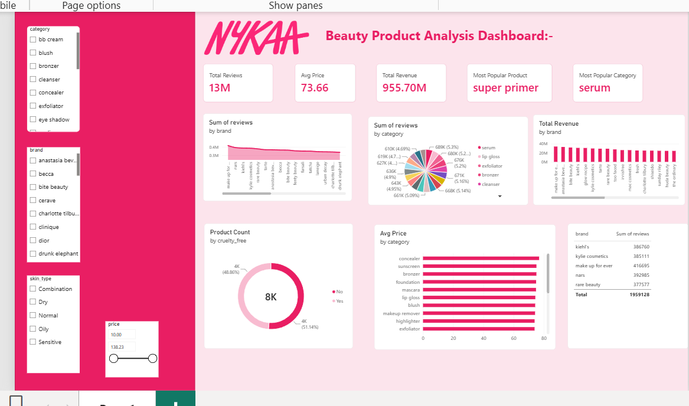

# Nykaa Beauty Product Analysis Dashboard

Python → MySQL → Power BI project.

> **Note:** The data is synthetic (dummy), made for practice. Layout inspired by a Power BI project I saw online.

## Tools
- Python (pandas): data cleaning
- MySQL: storage and SQL queries
- Power BI: DAX and dashboard

## Dataset
8,000 products, 40 brands, 20 categories.

## Dashboard
KPI cards, reviews and revenue by brand and category, cruelty-free split, top 5 brands, and slicers for category, brand, skin type and price.

## Files
- `cleaning.py`: data cleaning
- `queries.sql`: SQL analysis
- `nykaa.pbix`: Power BI file

Author: MEHAK PRADHAN 
